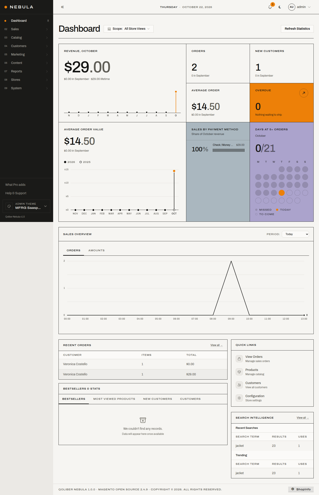

# Saasparilla for Nebula

A free theme for the Magento Open Source admin. It needs [Nebula](https://qoliber.com/nebula-admin.html), Qoliber's replacement for the standard Magento admin, which is free with a key from their site; this theme changes how Nebula looks.

The look comes from [Saasparilla](https://saasparilla.vercel.app), a design system by Christopher Dowson: paper-coloured surfaces, thin black lines where other admins use boxed panels, square corners, no drop shadows, the Archivo typeface, and colour used sparingly: one orange for the current page, today and the main button on a screen, flat blue and lavender panels to set areas of the dashboard apart, and green, amber and red only to say how something is doing.



It ships as one Composer package with three parts:

| Part | What it does |
| --- | --- |
| `MFRG_SaasparillaSkin` | A Nebula skin (the colour tokens, light and dark), the stylesheet that carries the rest of the design, and the bundled chart library. |
| `MFRG/saasparilla` theme | A child of `Nebula/backend` for template overrides. The first draws the dashboard sales chart with Saasparilla's SVG line chart instead of Chart.js. |
| `MFRG_SaasparillaDashboard` | An instruments row above the dashboard: revenue with a twelve-month trend, orders, new customers and average order value against last month, revenue share by payment method, unshipped orders, and a calendar of days that hit an orders target. |

## Requirements

- Magento Open Source 2.4.9 (the `magento/framework` 103.0.9 line).
- PHP 8.3, 8.4 or 8.5.
- Nebula 1.0, installed from Qoliber's Composer repository with your own key. Nebula is not included in this package and has its own licence.

## Install

Nebula first, if it isn't in yet. Qoliber issues the key when you add Nebula to your account; see their install guide.

```bash
composer config repositories.nebula composer https://composer.qoliber.com/r/nebula
composer config --global --auth bearer.composer.qoliber.com "YOUR_NEBULA_KEY"
composer require nebula/admin:^1.0 --with-all-dependencies
```

Then this package:

```bash
composer require mfrg/nebula-saasparilla
bin/magento setup:upgrade
```

In developer mode that is enough. In production mode run the usual deploy afterwards:

```bash
bin/magento setup:di:compile
bin/magento nebula:compile
bin/magento setup:static-content:deploy -f
bin/magento cache:flush
```

`setup:upgrade` runs a data patch that makes `MFRG/saasparilla` the admin theme for both of Nebula's theme settings and selects the `saasparilla` skin. Sign in and the admin is on paper.

## Configuration

**Skin.** The design loads only while the Saasparilla skin is selected under Stores › Configuration › Nebula › Settings › Color Scheme. Pick another Nebula skin and that skin shows unaltered; pick Saasparilla again to come back.

**Dashboard targets.** Under Stores › Configuration › MFRG › Dashboard:

- *Orders a day target*: a day with at least this many orders counts as a hit on the calendar. Default 5.
- *Overdue after (days)*: an order that is new or processing with no shipment after this many days is overdue. Default 2.

The instruments follow the dashboard's scope switcher, show base currency, group days by the store timezone, and cache their figures for five minutes.

## Switching back and removing

To use Nebula's own look without removing anything, choose another skin, or set the admin theme back:

```bash
bin/magento config:set nebula/theme/admin_theme Nebula/backend
bin/magento config:set nebula_theme_switcher/general/active_theme Nebula/backend
bin/magento config:set nebula/theme/skin indigo
bin/magento cache:flush
```

To remove the package, `bin/magento module:uninstall MFRG_SaasparillaSkin` restores those three values, then `composer remove mfrg/nebula-saasparilla`.

## Development

The package has to sit inside the Magento root when installed from a path repository, because Magento's template validator refuses real paths outside it. A checkout at `packages/nebula-saasparilla` with

```bash
composer config repositories.nebula-saasparilla path packages/nebula-saasparilla
composer require mfrg/nebula-saasparilla:@dev
```

works; a symlink to a sibling folder does not. On Magento 2.4.9 `cache:flush` can leave file-cache entries behind, so clear `var/cache` and `var/page_cache` by hand when a change does not show.

`tools/` holds the scripts used to check the theme against a running admin: screenshots, an axe-core accessibility run, a computed-style census for leftovers that break the system, and a label-to-control alignment check. See `tools/README.md`.

## Licence and credits

This package is released under the MIT licence; see `LICENSE`.

- Archivo, by Omnibus-Type, under the SIL Open Font License 1.1 (`src/Skin/view/adminhtml/web/fonts/LICENSE-Archivo.txt`).
- `saasparilla-charts.js` is the chart library from the Saasparilla theme, included by Christopher Dowson, its author, under this package's licence.
- Nebula is by Qoliber under the Nebula Community License and is a dependency, not part of this package.
